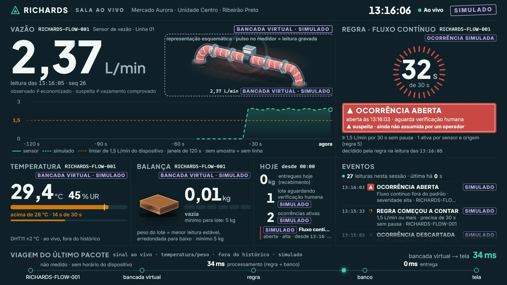
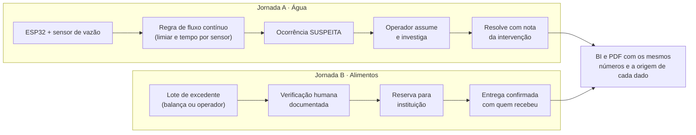
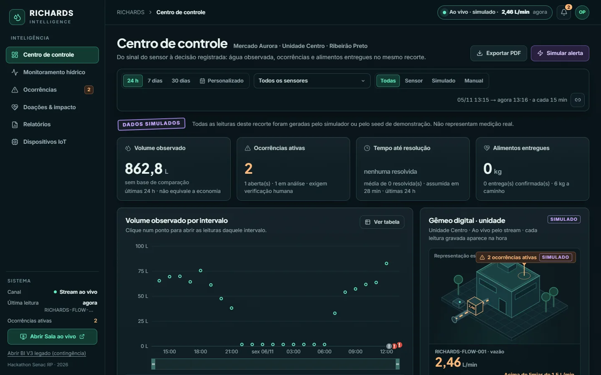
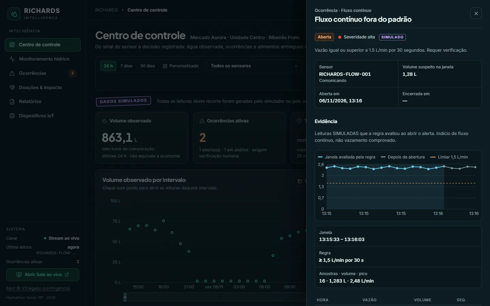
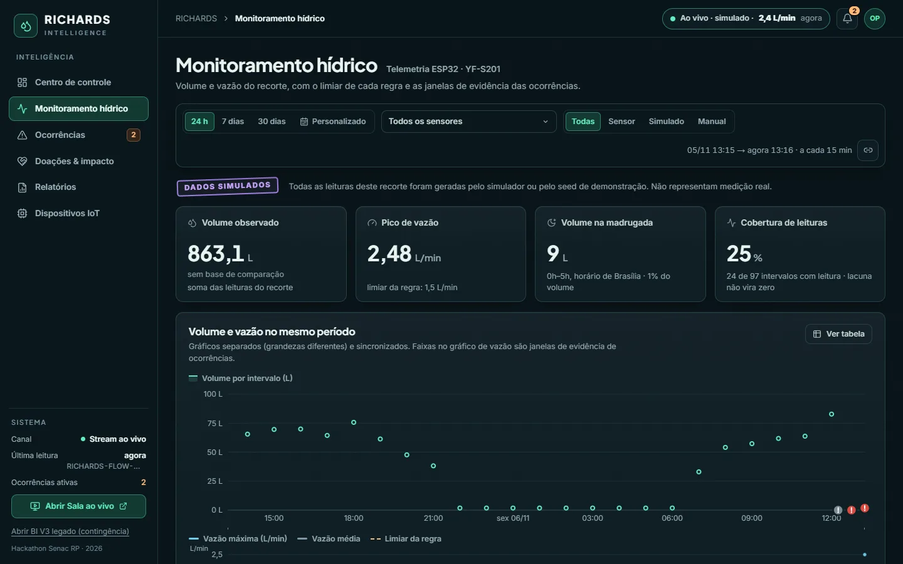
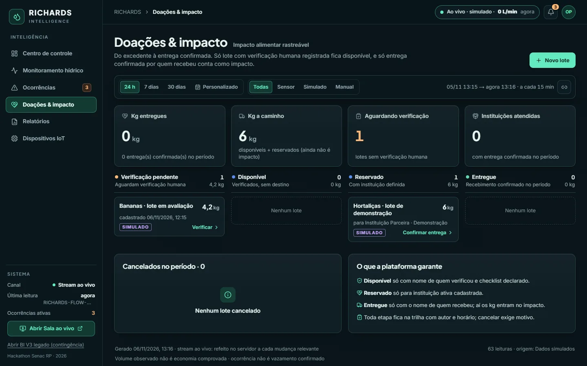
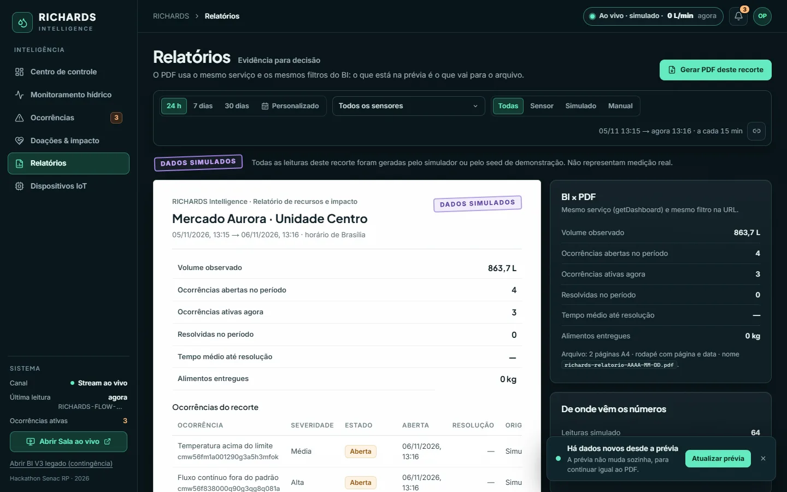
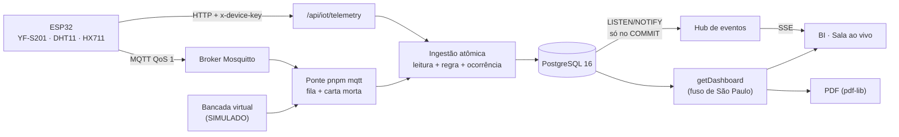

<div align="center">

# RICHARDS Intelligence

**Inteligência operacional para transformar sinais de desperdício de água e de alimentos em ações rastreáveis.**

Protótipo do **Hackathon Senac Ribeirão Preto**, 6 e 7 de novembro de 2026




<sub>A <b>Sala ao vivo</b>, feita para o telão. A captura vem do ensaio automatizado com a bancada virtual: todo dado na tela leva o carimbo <b>SIMULADO</b>. A demonstração usa só dados do sensor.</sub>

</div>

> [!IMPORTANT]
> **Protótipo de laboratório, não produto comercial validado.**
> - O ESP32 físico ainda não foi testado contra a plataforma.
> - A regra de vazão não foi calibrada em campo.
> - Litros **observados** não são litros **economizados**, e uma ocorrência **suspeita** não é um vazamento comprovado.

## Sumário

- [O problema e a proposta](#o-problema-e-a-proposta)
- [Telas](#telas)
- [Compromissos com o dado](#compromissos-com-o-dado)
- [Arquitetura](#arquitetura)
- [Como rodar](#como-rodar)
- [IoT: ESP32, MQTT e contingência](#iot-esp32-mqtt-e-contingência)
- [Testes e qualidade](#testes-e-qualidade)
- [Estrutura do repositório](#estrutura-do-repositório)
- [Documentação](#documentação)
- [Segurança e limites conhecidos](#segurança-e-limites-conhecidos)
- [Branches e contribuição](#branches-e-contribuição)
- [Equipe e créditos](#equipe-e-créditos)

## O problema e a proposta

Um comércio de alimentos perde água em fluxos contínuos que ninguém vê, como uma torneira mal fechada de madrugada ou uma descarga presa. Também descarta excedente que ainda poderia alimentar alguém. Os dois desperdícios deixam sinal, mas o sinal sozinho não muda nada.

> *O dado revela o desvio; a inteligência está em descobrir o que aconteceu depois.*

O RICHARDS liga o sensor à decisão registrada. Ele percorre duas jornadas, cada passo com autor, horário e auditoria.



### Novo caso de uso: escolas, descargas e instalações

O RICHARDS agora oferece uma **auditoria exploratória de 72 horas para pontos de consumo de água** em `/monitoramento` e `/dispositivos`. Ela apresenta dados físicos `DEVICE`, cobertura de leituras, último fluxo mensurável, volume na madrugada e no fim de semana. Ao selecionar um sensor **dedicado e calibrado** e declarar que havia uso esperado, a ausência de fluxo suficiente permite **abrir uma vistoria MANUAL** com trilha de auditoria.

**Atenção:** não se pode afirmar que uma descarga não foi usada ou está entupida apenas porque o sensor não registrou fluxo: o ponto pode estar isolado, ser compartilhado, ter sensor inadequado ou não haver ocupação. Sem comunicação confiável, a análise é bloqueada. Nenhuma inspeção é aberta automaticamente.

No mesmo painel, uma calculadora estima exposição financeira de um cenário de fluxo contínuo e, com filtro `source=DEVICE`, o valor indicativo do **volume noturno medido** usando tarifa informada pelo usuário. Isso não representa perda ou economia comprovada. [Critérios técnicos e normativos](docs/ESCOLAS_AGUA_E_DOACOES_LEGAIS.md).

## Telas

| | |
|---|---|
|  |  |
| **Centro de controle.** KPIs, volume por intervalo, fila de atenção e sinal ao vivo. O filtro mora na URL. | **Ocorrência.** Evidência gravada pela regra, linha do tempo com autor, assumir e resolver com nota obrigatória. |
|  |  |
| **Monitoramento.** Volume e vazão em gráficos separados e sincronizados, nunca com dois eixos Y. Intervalo sem leitura aparece como "sem dados", nunca como zero. | **Doações.** Do lote aguardando verificação humana até a entrega confirmada com o nome de quem recebeu. |
|  | |
| **Relatório.** A prévia e o PDF saem do mesmo serviço e do mesmo filtro: os números são iguais por construção. | |

<sub>Capturas feitas pelo ensaio automatizado, num banco de teste isolado e com o cenário de demonstração. Os dados levam o carimbo <b>SIMULADO</b> em roxo, como em toda tela e no PDF.</sub>

### Rotas

| Rota | Tela |
|---|---|
| `/` | Centro de controle |
| `/monitoramento` | Volume e vazão, com o limiar da regra |
| `/ocorrencias` | Central com busca, filtros e paginação |
| `/doacoes` | Quadro de lotes, da verificação à entrega |
| `/relatorios` | Prévia + PDF com o mesmo filtro (`/api/reports/summary`) |
| `/dispositivos` | Comunicação calculada pelo último contato |
| `/ao-vivo` | Sala ao vivo para o telão (tecla **F** = tela cheia, **3** = gêmeo 3D, **P** = pausa o movimento) |
| `/intelligence` | BI V3 legado em iframe, só como contingência |

Filtros na URL: `?range=24h|7d|30d` ou `from`/`to`, mais `deviceId` e `source`.

## Compromissos com o dado

As regras invioláveis vêm do prompt mestre (`docs/plano/16_PROMPT_MESTRE.md`) e são vigiadas por testes:

1. **Nada de número inventado.** Dado de demonstração leva o carimbo `SIMULATED` no banco, na API, na tela e no PDF.
2. **Observado ≠ economizado.** Volume medido nunca vira "litros economizados".
3. **A regra é configurável por sensor.** O fluxo contínuo é avaliado com `minFlowLpm` e `continuousSeconds` do dispositivo e só com leituras da mesma origem.
4. **A leitura é idempotente** por `(deviceId, bootId, sequence)`: a retransmissão do firmware não soma volume.
5. **Uma ocorrência ativa por sensor, tipo e origem.** A simulada nunca bloqueia a real, e duas reais ativas são impossíveis, mesmo sob concorrência (`pg_advisory_xact_lock`).
6. **Etapas da doação.** O lote só fica disponível com verificação humana documentada, e só é entregue com o nome de quem recebeu.
7. **Toda ação persistente** tem autorização, transação e auditoria. Leitura, regra, ocorrência e aviso ao vivo gravam numa transação só.
8. **Segredo nunca vai para o navegador.** O autor exibido no telão é mascarado.

## Arquitetura

O sistema é um monólito modular (DDD-lite) em Next.js. A API é fina e delega aos casos de uso; o domínio não depende de framework; os números saem sempre do PostgreSQL.



- **Tempo real sem peça nova.** O `NOTIFY` sai dentro da transação da gravação e só chega no COMMIT; a tela refaz a consulta ao receber o evento, e o navegador nunca soma número. Sem stream, ela volta à consulta periódica e diz isso na pílula de status.
- **Ponte MQTT.** É só um adaptador: passa pelos mesmos casos de uso do HTTP. Confirma ao broker na chegada e grava por uma fila com retentativa e prazo de relógio. O que não grava vai para a carta morta, nunca some em silêncio. As garantias e o risco residual estão em `docs/CONTRATO_IOT.md`.
- **Gêmeo do cano.**
  - A Sala tenta o 3D em three.js após carregar no cliente, respeitando a opção gravada e `?3d=0`. O SVG permanece montado como representação acessível e fallback; o BI não carrega a cena.
  - Qualquer falha volta ao SVG na hora: sem WebGL2, renderização por software, perda de contexto ou orçamento de quadro.
  - **Ampliar gêmeo** abre inspeção com o mesmo canvas, dois enquadramentos e dados em texto. A Sala passa a cartões com rolagem no celular; controles de toque e redução de movimento continuam disponíveis. [Revisão 3D/mobile e ensaios pendentes](docs/entrega/3D_MOBILE_HANDOFF_2026-11-07.md).
  - Temperatura e balança também possuem modelos opcionais sob demanda, sem animação autônoma. [Estado, fallback e aceite dos instrumentos](docs/entrega/INSTRUMENTOS_3D_HANDOFF_2026-11-07.md). [RICHARDS Circular](docs/propostas/RICHARDS_CIRCULAR.md) é proposta de evolução, ainda não implementada.
  - A velocidade da água vem da vazão medida.

### Stack

| Camada | Tecnologia |
|---|---|
| Aplicação | Next.js 16 (App Router), React 19, TypeScript strict, Tailwind 4 |
| Dados | PostgreSQL 16, Prisma 7 (adapter-pg), Zod 4 |
| Visualização | Recharts 2.15, three.js 0.186 (opcional), pdf-lib |
| IoT | ESP32 (Arduino), HTTP com chave por dispositivo, MQTT.js 5 + Mosquitto |
| Qualidade | node:test + tsx, Postgres real nos testes de integração, puppeteer-core no E2E |
| Entrega | Docker Compose (build de produção), Coolify na VPS |

## Como rodar

**Pré-requisitos:** Docker; para desenvolver, Node 22+ e pnpm 10.16.1.

### Demonstração com Docker

```bash
cp .env.example .env      # defina senhas e chave do sensor (nunca versione o .env)
docker compose up -d --build
```

- **Endereço:** http://localhost:3000. A saúde fica em `/api/health`.
- **Build:** o contêiner roda o build de produção e, a cada start, aplica as migrations pendentes e o cadastro-base (empresa, unidade, sensor e operador).
- **Dados reais:** a demo usa **só dados reais**. O BI começa em "sem dados" e se enche com as leituras do ESP32.
- **Para parar sem perder dados:** `docker compose down`, sem `-v`.

### Desenvolvimento

```bash
pnpm install
pnpm db:generate
pnpm db:deploy            # migrations versionadas (nunca reset em banco preservado)
pnpm db:seed              # cadastro-base; SEED_DEMO_DATA="true" cria o cenário fictício (só teste)
pnpm dev                  # http://localhost:3000
```

### Variáveis de ambiente

Os nomes estão em `.env.example`. Os valores ficam só no `.env` local.

| Variável | Para quê |
|---|---|
| `DATABASE_URL`, `POSTGRES_PASSWORD` | Banco da aplicação |
| `TEST_DATABASE_URL` | Banco **separado** dos testes (nome terminado em `_test`) |
| `RICHARDS_OPERATOR_USER`, `RICHARDS_OPERATOR_PASSWORD` | Login do operador (HTTP Basic de laboratório) |
| `IOT_DEMO_DEVICE_KEY` | Chave do sensor; igual à `RICHARDS_DEVICE_KEY` do `secrets.h` do ESP32 |
| `DEMO_MODE` | Libera a simulação carimbada (bancada virtual, botão Simular) |
| `MQTT_*` | Ponte da bancada MQTT: broker, tópico, apelidos, sensores simulados, prazo e carta morta |

### Só dados reais e instituição receptora

```bash
pnpm dados:limpar-simulados             # inventário: o que é SIMULATED e sairia (não apaga)
pnpm dados:limpar-simulados --apagar    # apaga só o SIMULATED, numa transação, com auditoria
pnpm instituicao:cadastrar --nome "Nome da instituição" --cidade "Ribeirão Preto"
```

O passo a passo, com backup e volta atrás, está em [`docs/DADOS_REAIS.md`](docs/DADOS_REAIS.md).

## IoT: ESP32, MQTT e contingência

- **ESP32 por HTTP.** O firmware fica em `iot/esp32_richards/`. Ele tem fila de 12 leituras, retentativa com a mesma `sequence` e horário por NTP, e espera 30 s quando recebe 401. O contrato está em [`docs/CONTRATO_IOT.md`](docs/CONTRATO_IOT.md).
- **Bancada MQTT.** A ponte é o `pnpm mqtt` (processo separado). O potenciômetro no lugar do sensor de vazão é gravado como `SIMULATED`. Com o YF-S201 ligado, use `MQTT_SIMULATED_SENSORS=""`.
- **Contingência de palco, tudo carimbado SIMULADO:**
  - `pnpm palco:checar` diz o que bloquearia o palco. Ele só lê o banco.
  - `pnpm bancada --cenario palco --inicio-em 5` move vazão, temperatura e balança.
  - `pnpm simulate --scenario leak --samples 14 --interval 4` se comporta como o firmware, pelo HTTP.

O roteiro de palco, com cliques e falas, está em [`docs/ROTEIRO_DEMO.md`](docs/ROTEIRO_DEMO.md).

## Testes e qualidade

```bash
pnpm typecheck && pnpm lint && pnpm build
pnpm test                    # unitários, sem banco
pnpm test:integration        # Postgres real em TEST_DATABASE_URL (*_test)
pnpm test:e2e                # jornadas no Chrome (instância isolada em :3100)
pnpm test:mqtt-broker        # Mosquitto real em porta isolada (Docker)
```

`--with-db-outage` derruba o banco por alguns segundos e só roda num Postgres **isolado**: exige `E2E_DB_CONTAINER` e `TEST_DATABASE_URL` apontando para ele. O banco da demonstração é recusado.

**Últimos resultados (06/11/2026)**

| Verificação | Resultado |
|---|---|
| typecheck, lint, build de produção | passou |
| Unitários | 112/112 |
| Integração (Postgres real) | 98/98 |
| E2E com queda de banco isolado | 42/42 (inclui o KPI nunca fora do intervalo e a Sala dizendo a verdade sem banco) |
| Broker MQTT real | 6/6 (keepalive de 2 s com o banco fora por 9 s: 0 queda, 4/4 gravadas com a hora de chegada) |
| Ensaio do hackathon (12 passos + queda, duplicata e retentativa) | 14/14 |
| ESP32 físico contra a plataforma | **não executado** (depende do teste da equipe de IoT) |
| 3D no projetor do evento | **não executado** |

## Estrutura do repositório

```text
src/
  app/(bi)/            telas do BI e layout persistente
  app/(palco)/         Sala ao vivo (CSS próprio, escopado)
  app/api/             APIs finas: IoT, analytics, ocorrências, doações, relatórios, stream ao vivo
  modules/             domínio e casos de uso: monitoring, donations, analytics, reports, realtime, audit, admin
  components/bi/       telas, gráficos, gavetas e primitivas do BI
  components/stage/    Sala ao vivo: lógica pura, redutor, gêmeo SVG/3D
  iot/                 ponte MQTT e bancada virtual
  admin/               comandos de terminal (dados reais, instituição)
prisma/                schema, migrations versionadas e seed
iot/esp32_richards/    firmware do ESP32 (Arduino)
tests/                 unitários e integração (tests/integration)
scripts/               E2E, simulador do sensor, fumaça MQTT, geradores de documentação
docs/                  contratos, decisões, roteiros, modelo de dados e imagens
presentation/          kit de pitch (slides, fala, roteiro de palco)
```

## Dossiê de avaliação Senac 2026

A documentação da equipe sobre impacto social, viabilidade, inovação, UX e pitch está em [**docs/avaliacao-hackathon-2026**](docs/avaliacao-hackathon-2026/README.md). A [atualização sobre escolas, água, vistorias e doações](docs/avaliacao-hackathon-2026/00_LEIA_AQUI_ATUALIZACAO_2026-11-07.md) diferencia código implementado, hipóteses financeiras e evidências ainda pendentes. Os materiais originais vieram do [dossiê da Bruna](https://github.com/brunamed96/Richards-Hackathon-2026-Avaliacao), preservados em sua organização original.

## Documentação

| Documento | Conteúdo |
|---|---|
| [`MEMORIA.md`](MEMORIA.md) | Estado completo: decisões, pendências e armadilhas. **Comece por aqui** |
| [`docs/CONTRATO_IOT.md`](docs/CONTRATO_IOT.md) | HTTP do ESP32, canal MQTT, garantias e riscos residuais, stream ao vivo |
| [`docs/ROTEIRO_DEMO.md`](docs/ROTEIRO_DEMO.md) | Roteiro de palco com cliques, falas e contingências |
| [`docs/DADOS_REAIS.md`](docs/DADOS_REAIS.md) | Limpeza do cenário fictício, instituição real, backup e volta atrás |
| [`docs/DEPLOY_VPS_TETRIA.md`](docs/DEPLOY_VPS_TETRIA.md) | Publicação na VPS, auditoria de segurança e plano de HTTPS |
| [`docs/ARQUITETURA.md`](docs/ARQUITETURA.md) | Contextos, camadas e decisões de arquitetura |
| [`docs/dados/`](docs/dados/) | Dicionário de dados (Excel), MER e DER |
| [`docs/plano/`](docs/plano/) | Produto, escopo, API, testes de aceite e prompt mestre |
| `docs/FASE_*.md` | Registro de cada fase de entrega |
| [`presentation/`](presentation/) | Kit de pitch: slides, fala de 5min40 e roteiro de palco |

## Segurança e limites conhecidos

- **Acesso.**
  - A senha é única, de laboratório (HTTP Basic).
  - Não exponha a demo na internet aberta sem TLS. O plano de HTTPS da VPS está em `docs/DEPLOY_VPS_TETRIA.md`.
  - Login por usuário e papéis já têm tabela no banco, mas ainda não têm tela.
- **ESP32.** O firmware HTTP não tem TLS: use só em rede isolada.
- **MQTT.**
  - O broker sem usuário só é aceito com `DEMO_MODE`.
  - Uma ACL por dispositivo está documentada em `docs/CONTRATO_IOT.md`.
- **Ponte MQTT.** A fila vive na memória. Se o processo morrer com mensagens esperando o banco, elas se perdem, e esse é um risco aceito e documentado. Entrega "exatamente uma vez" **não** é prometida.
- **Instituição.** Ela não tem login próprio: quem confirma a entrega é o operador.

## Branches e contribuição

| Branch | Papel |
|---|---|
| `develop` | Integração. Todo trabalho e todo pull request entram aqui |
| `main` | Estável. Só recebe a `develop` já testada; é a versão publicada na demonstração |

Antes de abrir um PR para a `develop`, rode `pnpm typecheck`, `pnpm lint` e `pnpm test`. Se a mudança tocar banco, IoT ou telas, rode também os testes de integração e o E2E. Não versione segredos: `.env`, `secrets.h` e credenciais ficam fora do git. As branches antigas do kit de pitch estão guardadas nas tags `arquivo/feat-pitch-*`.

## Equipe e créditos

- **Equipe:** quatro pessoas, duas de desenvolvimento e duas de IoT, no Hackathon Senac Ribeirão Preto 2026.
- **Nome:** homenageia **Ellen Swallow Richards** (1842–1911), química do MIT e pioneira da qualidade da água e da ciência sanitária.
- **Kit de pitch:** fica em [`presentation/`](presentation/).

<p align="center"></p>


## Experiência da plateia por QR (develop, 07/11/2026)

- Operador acessa /convite (Basic Auth) para projetar QR Code offline, apontando para http://187.77.229.205:8090/plateia.
- Plateia acessa /plateia sem senha: vazão, temperatura, umidade e peso em SSE público SOMENTE leitura, com selo de dados reais/simulados e indicação de leituras desatualizadas. /api/plateia/stream expõe só campos sanitizados, não o stream privado do BI.
- O BI principal agora mostra DHT11 e HX711 em Centro de Controle, Monitoramento e Dispositivos, com sinais efêmeros. Sem pacote novo, não apresenta valores como atuais; histórico continua só para vazão.
- Gatilho padrão da ponte MQTT da balança física: 1,5 kg por 6s, após tara/calibração; não confundir com o limite nominal de 5 kg da célula do Victor. Bancada virtual mantém cenário independente.
- 70 espectadores é ALVO de teste, não benchmark já executado. Use scripts/plateia-carga.mjs; instruções, riscos e handoff para Claude em docs/entrega/PLATEIA_QR_IOT_HANDOFF_2026-11-07.md. A main só deve receber essa entrega após aceites reais.

## RICHARDS Assist e Telegram (opcional)

O assistente privado em `/assistente` consulta o BI e ajuda a entender as ocorrências. O worker de Telegram acompanha eventos persistidos, mantém fila de entregas/retentativas e funciona independentemente do navegador e da IA. Tudo fica desativado por padrão.

Ativação, configuração e limites: [`docs/assistente/README.md`](docs/assistente/README.md). Revisão e testes pendentes para Claude: [`docs/assistente/HANDOFF_CLAUDE.md`](docs/assistente/HANDOFF_CLAUDE.md). Não colocar chaves em código nem expor as rotas do assistente à plateia pública.
