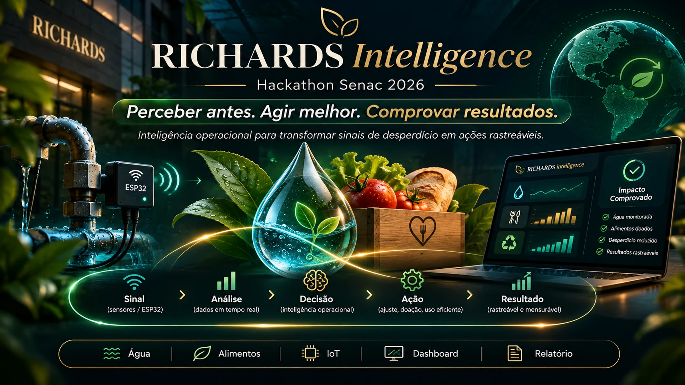

# RICHARDS Intelligence — Apresentação em imagens

A versão visual oficial para o Hackathon Senac 2026 agora é composta por **10 imagens cinematográficas individuais**, em **1920 × 1080 (Full HD)**, sem necessidade de PowerPoint.

## [Abrir a galeria completa de imagens](imagens/README.md)

| Ordem | Arte | Assunto |
|---|---|---|
| 01 | [01_capa.webp](imagens/01_capa.webp) | Abertura — RICHARDS Intelligence |
| 02 | [02_problema.webp](imagens/02_problema.webp) | O custo de perceber tarde demais |
| 03 | [03_origem_nome.webp](imagens/03_origem_nome.webp) | Origem do nome — Ellen Swallow Richards |
| 04 | [04_solucao.webp](imagens/04_solucao.webp) | Da medição à ação verificável |
| 05 | [05_agua.webp](imagens/05_agua.webp) | Jornada da água — IoT do Victor |
| 06 | [06_alimentos.webp](imagens/06_alimentos.webp) | Jornada dos alimentos — doação com confirmação |
| 07 | [07_plataforma.webp](imagens/07_plataforma.webp) | Plataforma — exemplo visual do painel |
| 08 | [08_diferencial.webp](imagens/08_diferencial.webp) | Nosso diferencial — dado em ação |
| 09 | [09_impacto.webp](imagens/09_impacto.webp) | Impacto operacional, ambiental e social |
| 10 | [10_encerramento.webp](imagens/10_encerramento.webp) | Encerramento — propósito e evidência |

## Narrativa e integração

- [Fala natural para apresentação (5 min 40 s)](FALA_5MIN40.md)
- [Roteiro de palco e contingências](ROTEIRO_PALCO.md)
- [Checklist de integração IoT do Victor](CHECKLIST_VICTOR_IOT.md)
- [Plano final de qualidade e testes](PLANO_FINAL.md)

A apresentação conecta **problema → inspiração do nome → solução → sensor e ação → alimento e impacto → diferencial → fechamento**. No palco, use as imagens para contar a história e **o sistema real** para comprovar funcionamento.

> **Integridade dos resultados:** os números inseridos pela geração de imagens nos quadros e telas são apenas ilustrativos. Não representam água economizada, alimentos entregues ou resultados de pilotos. A versão atual detecta fluxo suspeito por regra configurável, sem modelo preditivo treinado. Não apresentar como IA preditiva validada.

## Exportação para a banca

O PDF e PowerPoint preparados nesta revisão mantêm as 10 imagens, com aviso visível de arte conceitual e números ilustrativos. As notas do PowerPoint incluem a sequência e os papéis do roteiro. São slides baseados em imagens; o texto interno das artes não é editável. Conferir estes arquivos antes de usar `--pdf` e `--pptx` no gerador do ZIP. Não usar `render_slides.py`, que exporta a sequência histórica.

## Material anterior (arquivo histórico)

A antiga sequência de 14 [peças vetoriais SVG](slides/) foi preservada como referência histórica, mas **não é mais a apresentação principal**. O script [render_slides.py](render_slides.py) pertence à versão anterior. A atual é acessada pelas imagens acima.

**O código da plataforma, contratos da API e firmware ESP32 não foram alterados nesta atualização visual.**
