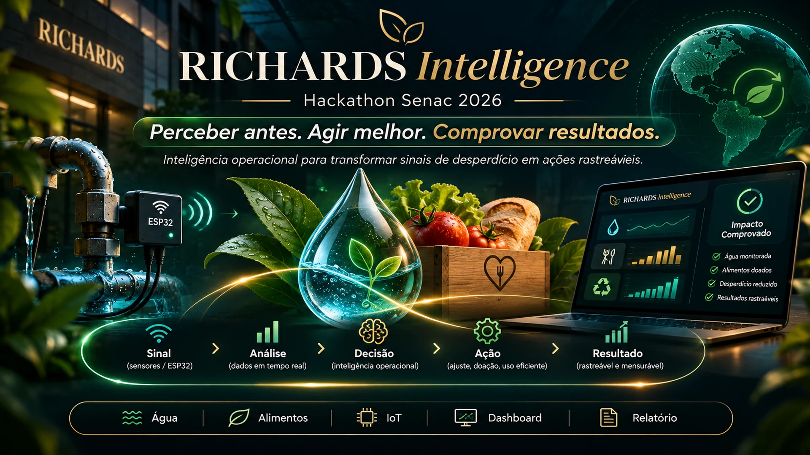
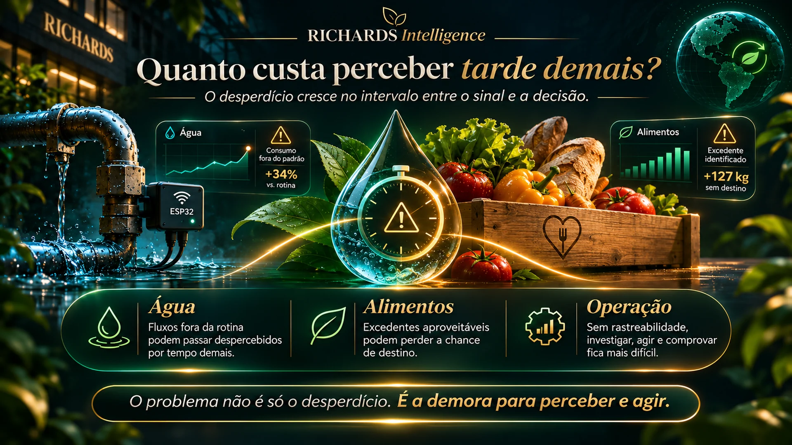
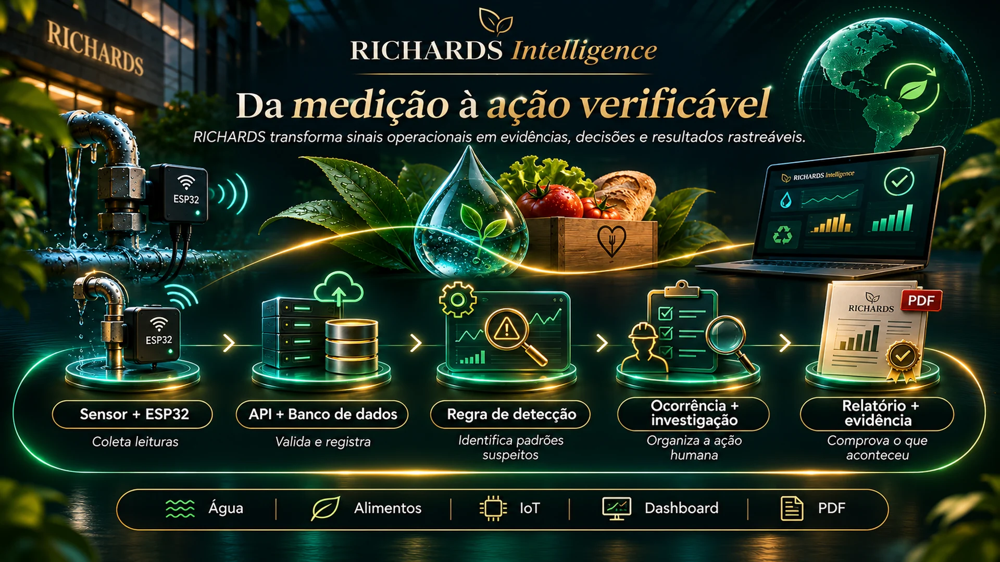
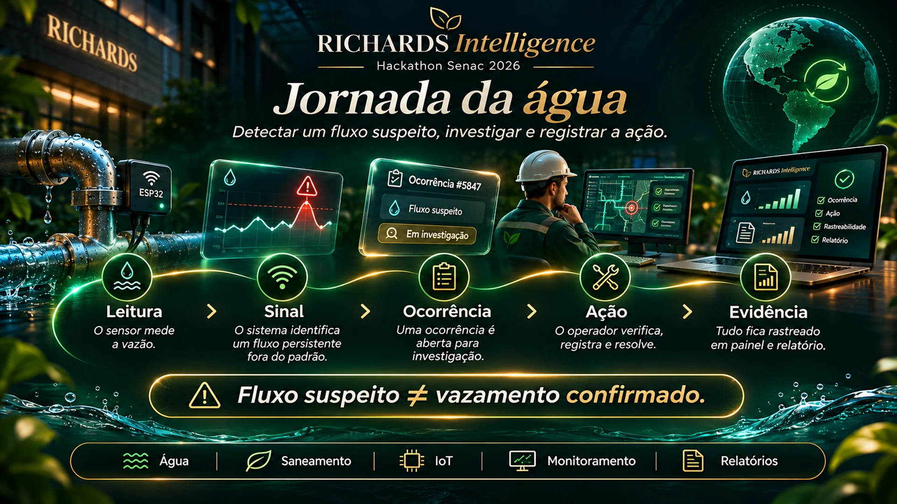
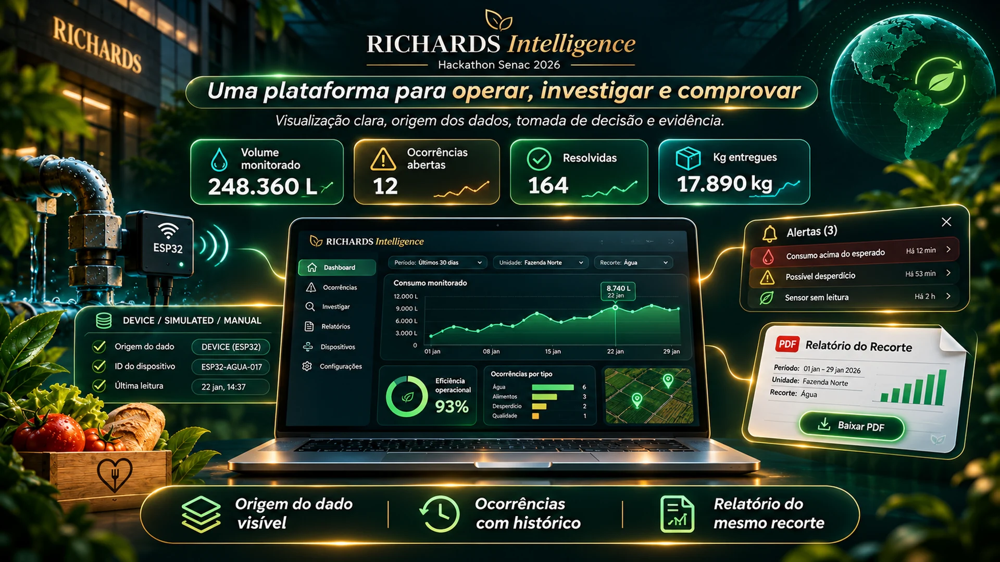
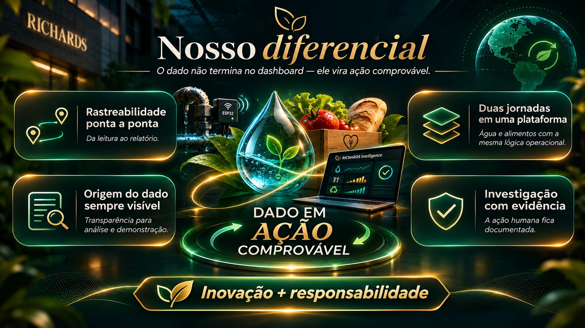
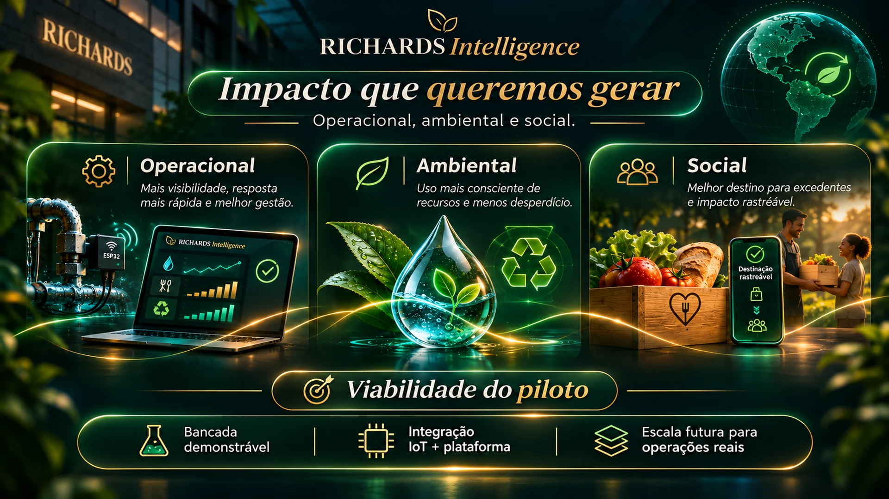
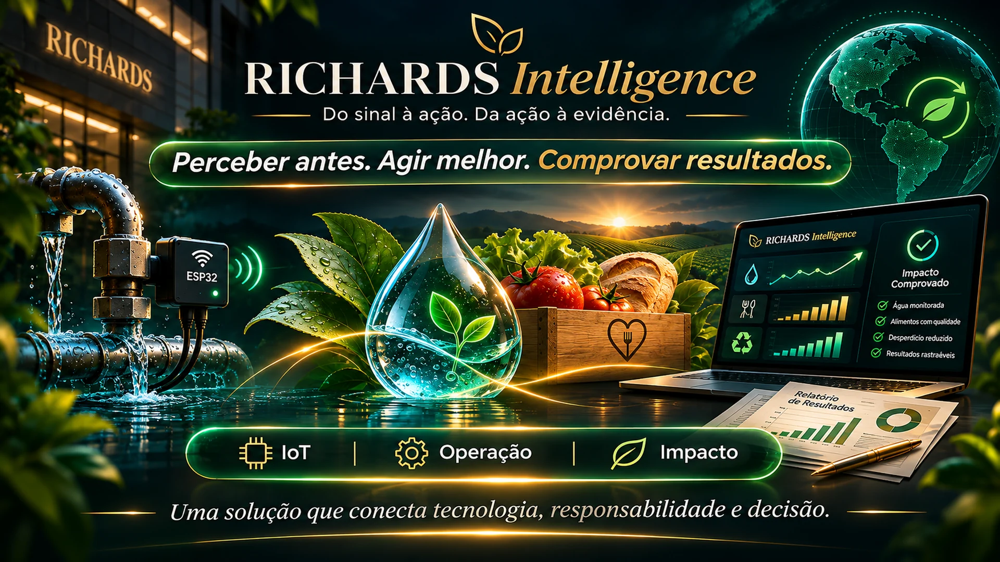

# RICHARDS Intelligence — pitch em imagens

**Apresentação oficial em imagens cinematográficas (1920 × 1080, 16:9, WebP).** Cada imagem pode ser aberta individualmente, sem precisar de PowerPoint.

> **Atenção:** estas artes foram geradas por IA. O visual da plataforma é conceitual, e os números desenhados nos quadros e dashboards são **fictícios**, não resultados medidos. Para demonstrar o protótipo real, abra as rotas da aplicação e sinalize dados `DEVICE` ou `SIMULATED`.

## Abertura — RICHARDS Intelligence

[Visualizar imagem em tela cheia](01_capa.webp)

## O custo de perceber tarde demais

[Visualizar imagem em tela cheia](02_problema.webp)

## Origem do nome — Ellen Swallow Richards

[Visualizar imagem em tela cheia](03_origem_nome.webp)

## Da medição à ação verificável

[Visualizar imagem em tela cheia](04_solucao.webp)

## Jornada da água — IoT do Victor

[Visualizar imagem em tela cheia](05_agua.webp)

## Jornada dos alimentos — doação com confirmação

[Visualizar imagem em tela cheia](06_alimentos.webp)

## Plataforma — exemplo visual do painel

[Visualizar imagem em tela cheia](07_plataforma.webp)

## Nosso diferencial — dado em ação

[Visualizar imagem em tela cheia](08_diferencial.webp)

## Impacto operacional, ambiental e social

[Visualizar imagem em tela cheia](09_impacto.webp)

## Encerramento — propósito e evidência

[Visualizar imagem em tela cheia](10_encerramento.webp)

## No palco

Mostre as imagens 1–4 para abrir a história; passe para a demonstração ao vivo com o ESP32 do Victor nas imagens 5–7; finalize com diferenciais, impacto e encerramento. A regra atual aponta **fluxo suspeito**, não prova vazamento. A etapa de doação exige verificação humana e confirmação de entrega. IA preditiva é uma etapa futura, não uma capacidade validada do MVP.

[Texto de fala 5min40](../FALA_5MIN40.md) · [Roteiro de demonstração](../ROTEIRO_PALCO.md) · [Checklist do Victor](../CHECKLIST_VICTOR_IOT.md)
