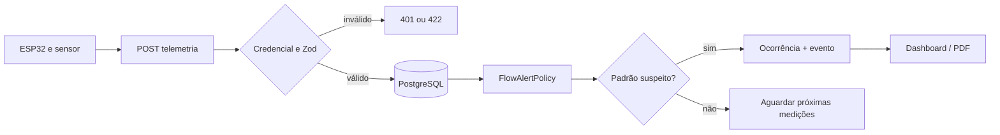
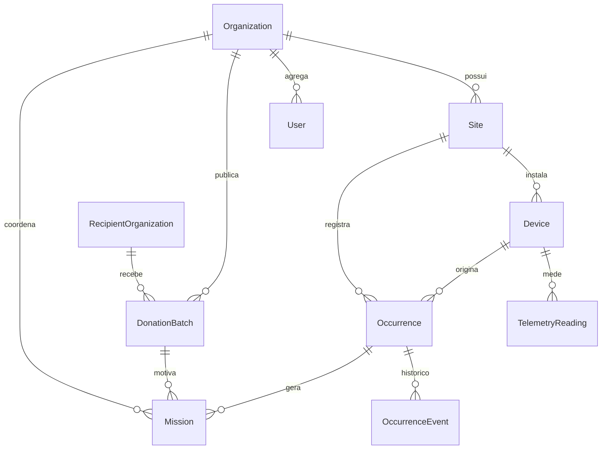

# RICHARDS Intelligence — Arquitetura 0.1

## Decisão de arquitetura

**Monólito modular DDD-lite + Clean Architecture**, desenvolvido em Next.js 16.2, TypeScript, React e PostgreSQL. **Não** criar API NestJS separada durante o MVP. Arquitetura modular preserva separação de responsabilidades sem sobrecarga de infraestrutura.

### Bounded contexts

1. **Identidade / Organização** — organização, unidade (Site), pessoas e papéis.
2. **IoT / Monitoramento** — dispositivos, telemetria (imutável), autenticação e política de vazão.
3. **Ocorrências** — ciclo de vida e histórico de ações.
4. **Doações** — lote, validação sanitária humana, instituição, reserva, entrega.
5. **Missões (preparado, não implementado no MVP)** — modelo para vincular vistorias e coletas a responsáveis e oportunidades futuras para estudantes/profissionais.
6. **Analytics / Relatórios** — consultas e agregações sobre fatos persistidos; projeções não podem sobrescrever dados originais.

### Camadas

- `domain`: políticas puras, estados e invariantes, objetos de valor.
- `application`: casos de uso, orquestração, autorização e transações.
- `infrastructure`: Prisma, conectores, adapters, consultas BI.
- `app/api`: HTTP — recebe e valida contrato com Zod, delega ao caso de uso, converte erros em status HTTP.
- `components`: UI React responsiva, gráficos, tabelas e filtros.

### Estrutura resumida

```text
src/
  app/                         # páginas e rotas de API
    api/iot/telemetry/         # entrada isolada da ESP32
    api/analytics/overview/    # DTO para dashboards
    api/occurrences/[id]/      # workflow
    api/donations/             # lotes
    api/reports/summary/       # PDF
  modules/
    monitoring/domain          # FlowAlertPolicy
    monitoring/application     # IngestTelemetry, OccurrenceService
    donations/domain          # DonationWorkflow
    analytics/application      # GetOverview
    analytics/infrastructure   # dados demo explicitamente identificados
  components/                  # BI
  lib/                         # conexão e configurações
prisma/                        # esquema e seed
scripts/                       # simulador de telemetria
iot/                           # firmware ESP32
```

## Fluxo IoT



## Regras que NÃO podem quebrar

- Cada medição registra origem, dispositivo, bootId, sequência e data de captura. `@@unique(deviceId, bootId, sequence)` torna repetição idempotente.
- `deltaLiters` é volume medido entre leituras; a soma produz volume monitorado. **Não** é economia.
- Alerta representa **suspeita**; necessita confirmação humana.
- Doação só se torna `AVAILABLE` após a verificação humana/sanitária; `DELIVERED` só após vínculo de instituição e confirmação.
- Apresentação no hackathon deve distinguir `SIMULATED`, `DEVICE`, `MIXED`.
- Auditoria de alterações e autorizações mais detalhadas é uma pendência obrigatória antes de produção.

## Banco (relacionamentos)



## Segurança — estado atual

- API IoT autentica por `x-device-key`, comparada por hash SHA-256 com comparação timing-safe.
- Operações humanas usam **HTTP Basic somente no protótipo** via `src/proxy.ts`. **Nunca** exposição em HTTP na internet. Para produção: Auth.js/OIDC, RBAC, controle por organização, TLS, revogação de credenciais e auditoria.
- `DEMO_MODE=true` permite simulação e fallback visual quando o banco não estiver disponível. **Jamais** habilitar em ambiente produtivo.
- API permite um dispositivo de prova por organização; caso escale, revisar concorrência de criação de ocorrências, detecção de perda de pacotes e políticas por horário.
- CORS não está liberado; ESP32 consome a API servidor-servidor.
- Faltam na versão-base: rate limiting, rotação de chaves, alerta por ausência de telemetria via job, isolamento multi-tenant real e backup testado.

## Gaps conhecidos do sensor

YF-S201 é para **demonstração em bancada**, não sensor de precisão/segurança do sistema de abastecimento. A depender da versão e das condições, sua faixa declarada começa em cerca de 1 L/min; microvazamentos podem passar despercebidos. A calibração é indispensável. O protótipo NÃO fecha válvula automaticamente.
