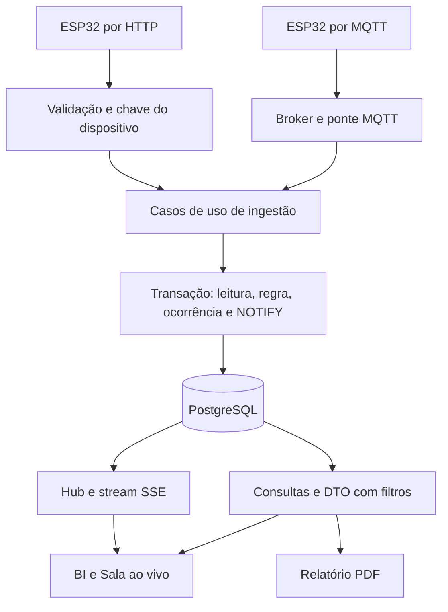

# RICHARDS Intelligence — arquitetura e escopo da entrega

Revisão: 07/11/2026. Monólito modular DDD-lite em Next.js 16, React 19 e TypeScript strict, com PostgreSQL 16 e Prisma 7. As versões exatas das dependências estão em `pnpm-lock.yaml`. Esta documentação descreve o código atual; `docs/plano/` preserva o planejamento inicial.

## Componentes e responsabilidades

| Componente | Implementação e responsabilidade |
|---|---|
| BI operacional | `src/app/(bi)/` e `src/components/bi/`: seis telas React nativas, filtros na URL, consultas ao servidor e estados de indisponibilidade |
| Sala ao vivo | `src/app/(palco)/` e `src/components/stage/`: telão, leituras, regra, sensores e eventos. SVG padrão e Three.js opcional sob demanda |
| API HTTP | `src/app/api/`: autenticação, validação Zod, chamada dos casos de uso e tradução de erros |
| Monitoramento | `src/modules/monitoring/`: ingestão idempotente, política configurável de fluxo, ocorrências e conectividade |
| Ponte MQTT | `src/iot/`: processo separado `pnpm mqtt`, valida payload, mapeia dispositivos e usa os mesmos casos de uso. Fila em memória com retentativa e carta morta |
| Doações | `src/modules/donations/`: verificação humana, reserva para instituição ativa e entrega com responsável pelo recebimento |
| Analytics/PDF | `src/modules/analytics/` e `src/modules/reports/`: agregações no servidor e PDF sobre o mesmo DTO e filtros do painel |
| Tempo real | `src/modules/realtime/`: PostgreSQL LISTEN/NOTIFY, hub por processo e SSE para o navegador |
| Persistência | `prisma/schema.prisma`, migrations versionadas e seed idempotente de cadastro-base |
| Auditoria | Eventos com autor e horário nas operações persistentes; o telão recebe somente os campos públicos necessários |
| Firmware | `iot/esp32_richards/`: ESP32 por HTTP. Firmware MQTT do Victor ainda pendente de envio/versionamento |

O domínio contém políticas e transições em TypeScript. Os casos de uso coordenam autorização, transações e persistência. As rotas HTTP são adaptadores. O navegador recebe DTOs e não calcula agregados de negócio somando eventos recebidos.

## Caminho da telemetria

- HTTP autentica por `x-device-key`; o banco guarda o hash da chave.
- A leitura é única por `(deviceId, bootId, sequence)`. Uma retransmissão válida não duplica volume.
- Leitura, avaliação da regra, ocorrência e notificação são atômicas. O PostgreSQL entrega o NOTIFY após o COMMIT.
- Uma ocorrência ativa por dispositivo, tipo e origem é protegida com advisory lock e consulta na mesma transação. Uma origem simulada não bloqueia a real.
- O cliente refaz consultas ao receber eventos que afetam agregados. Sem stream, consulta periodicamente e informa a condição. Sem banco, informa indisponibilidade e não cria números substitutos.
- Vazão usa série persistida. Temperatura, umidade e peso também podem aparecer no canal efêmero `sensor.live`; isso não equivale a uma série histórica persistida de todos os sensores. Ver `CONTRATO_IOT.md`.
- A ponte confirma a chegada ao broker e trata a gravação numa fila em memória. Retentativas têm prazo. Erros permanentes e mensagens que não gravam vão para a carta morta. Morte abrupta do processo pode perder a fila; não há promessa de entrega exatamente uma vez.

## Jornadas e regras de interpretação

Água: leitura aceita, fluxo persistente conforme limiar e duração do dispositivo, ocorrência suspeita, investigação assumida e resolução com nota. O sensor não diagnostica automaticamente o defeito nem fecha válvulas. Volume observado não é economia comprovada.

Alimentos: lote `PENDING_REVIEW`, verificação humana documentada, `AVAILABLE`, reserva para instituição ativa, `RESERVED`, confirmação de recebimento e `DELIVERED`. Somente entregas confirmadas entram no indicador de quilos entregues, pela data de recebimento. No MVP, o operador registra a confirmação; a instituição não tem login próprio.

As origens `DEVICE`, `SIMULATED` e `MANUAL` acompanham os registros conforme o contrato de cada jornada. Indicadores agregados podem ser `MIXED`. Potenciômetro não mede água e permanece identificado como simulação. O seed padrão não cria histórico fictício; o cenário de teste exige ativação explícita.

## Visualização e desempenho

O BI usa Recharts e interfaces React. `/intelligence` preserva o HTML V3 em iframe apenas como contingência.

Na Sala, o SVG permanece como representação acessível e fallback. O 3D usa Three.js imperativo em módulo carregado sob demanda, sem CDN nem dependência externa de modelos. A velocidade visual vem da vazão recebida; sem leitura recente, a água para. O pulso do medidor indica a chegada de uma leitura gravada.

Movimento reduzido, WebGL indisponível, renderização por software, falhas de contexto e orçamento de quadros podem levar ao SVG. DPR é limitado e a cena suspende o desenho em aba oculta. Pausar movimento não interrompe a recepção dos dados. A indicação do modo efetivo e os controles visíveis ajudam a operar o telão. Ensaio em GPU/projetor reais continua obrigatório.

## Banco e implantação local

O modelo cobre organizações, unidades, dispositivos, leituras, ocorrências/eventos, instituições, lotes e auditoria. `Mission` e papéis de usuário existem no schema, mas não representam jornadas completas implementadas. MER, DER e dicionário estão em `docs/dados/`.

`docker compose up -d --build` inicia PostgreSQL e web; a web aplica migrations pendentes e o cadastro-base na partida. O perfil opcional `iot` acrescenta broker autenticado e ponte MQTT. O template `.env.example` deve ser preenchido localmente. O pacote não transporta credenciais, banco local nem histórico Git. Instruções de instalação em `README.md`.

## Segurança e limites de escopo

- HTTP Basic é o acesso de operador do laboratório. Autenticação de produção com sessão/OIDC, RBAC completo e isolamento multi-tenant ainda exige evolução.
- TLS não está implementado no firmware HTTP. Usar esse canal somente em rede de laboratório isolada. Riscos e decisões da VPS estão documentados separadamente; esta revisão não altera a implantação.
- MQTT usa credenciais e ACL no Compose. O grau de isolamento depende da configuração de rede; não expor broker anônimo.
- Logs e evidências precisam de revisão humana para retirada de credenciais e dados pessoais antes da entrega.
- Não há modelo preditivo de IA validado, economia comprovada, certificação sanitária automática, controle remoto de válvulas ou portal próprio da instituição no MVP.
- Compilação do firmware, calibração, testes do ESP32 físico e desempenho no projetor dependem das evidências da equipe. Teste automatizado do software não aprova esses itens.

Contratos: `CONTRATO_IOT.md`. Escopo inicial e critérios: `docs/plano/01_PRODUTO_E_OBJETIVOS.md` e `02_ESCOPO_FUNCIONAL_CRITERIOS.md`. Estado de execução: `docs/entrega/AUDITORIA_2026-11-06.md` e `REGISTRO_TESTE_FISICO.md`. Roteiro: `docs/ROTEIRO_DEMO.md` e `presentation/FALA_5MIN40.md`.

## Circular — módulo opcional de rastreabilidade

`src/modules/circular` mantém contratos no domínio, transações/quantidades na aplicação e autenticação/anexos na infraestrutura; APIs finas em `/api/circular/*` e UI em `/circular`. `CircularPartner`, `CircularBatch` e `CircularEvidence` acrescentam dados sem alterar telemetria, regras ou firmware. Ligação opcional única com `DonationBatch`, sempre pendente de verificação humana. Documentos ficam no PostgreSQL e não no bundle público. AuditEvent compartilha a transação. Feature desligada por padrão; não integra ainda o worker Telegram. Fluxo e limites em `docs/circular/README.md`.
