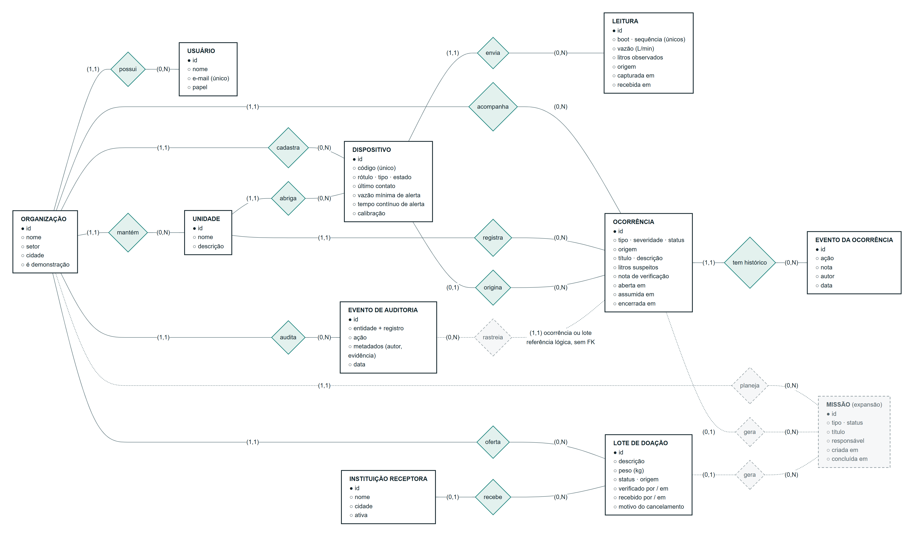
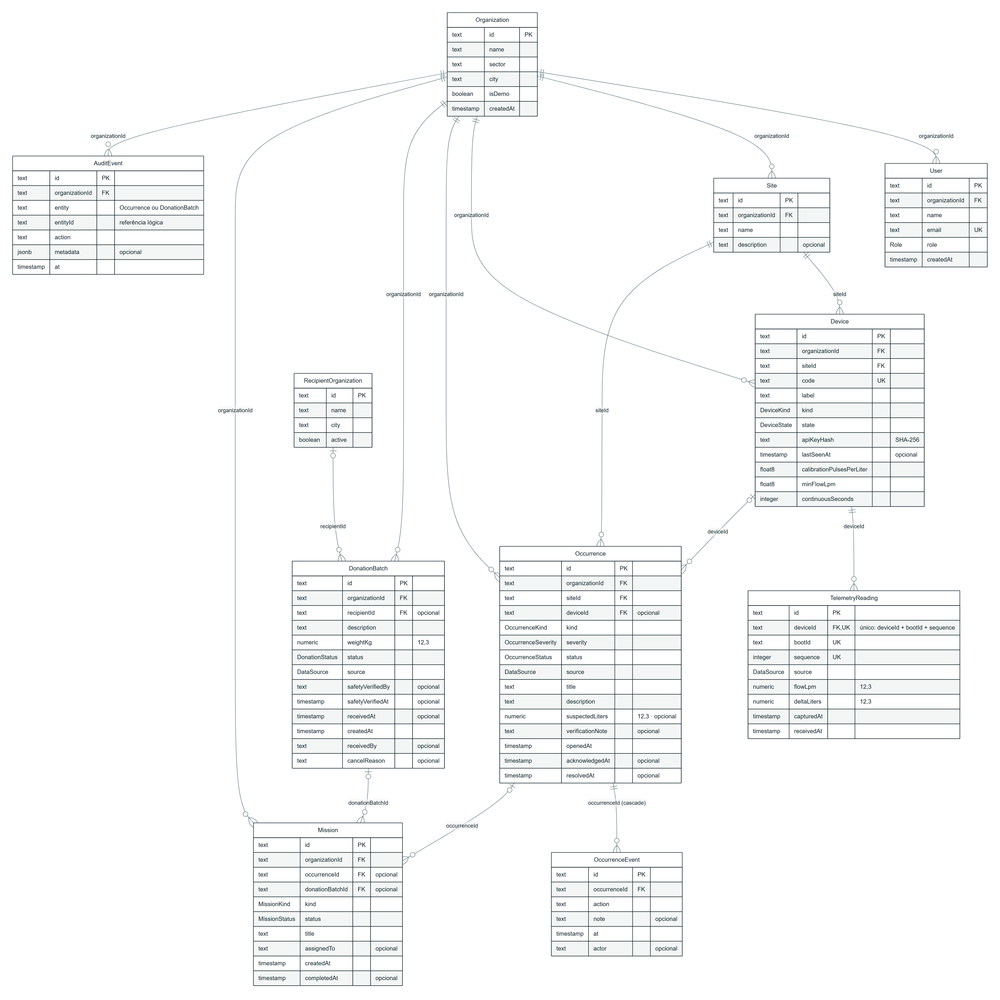

# Modelo de dados — dicionário, MER e DER

Tudo aqui reflete o banco real (PostgreSQL 16, schema `public`). A fonte da verdade é `prisma/schema.prisma` com as 3 migrations aplicadas. Em 03/11/2026 o conteúdo foi conferido contra o `information_schema`, o `pg_constraint`, o `pg_indexes` e o `pg_enum`: 11 tabelas, 92 colunas, 15 chaves estrangeiras, 20 índices, 10 enums e 36 valores, sem divergência.

| Arquivo | O que é |
|---|---|
| `DICIONARIO_DE_DADOS.xlsx` | Dicionário de dados em Excel. Detalhes na tabela abaixo. |
| `MER_DER.pdf` | Os dois diagramas prontos para entregar ou imprimir. MER em A3 paisagem, DER em A3 retrato. |
| `MER.png` / `MER.svg` | MER conceitual: entidades, relacionamentos e cardinalidade (mín,máx), em notação de Chen. |
| `DER.png` / `DER.svg` | DER lógico: tabelas físicas, tipos, PK/FK/UK e linhas em pé de galinha. |
| `mer.mmd` / `der.mmd` | Fontes editáveis em Mermaid. Abrem também em https://mermaid.live. |

Abas do `DICIONARIO_DE_DADOS.xlsx`:

| Aba | Conteúdo |
|---|---|
| Sobre | Resumo com contagens em fórmula e conferência com o banco. |
| Tabelas | As 11 tabelas, com o nome de negócio de cada uma. |
| Dicionário | As 92 colunas: tipo, obrigatoriedade, padrão, chave, valores permitidos, validação e exemplo. |
| Relacionamentos | As 15 chaves estrangeiras, com cardinalidade e ON DELETE / ON UPDATE. |
| Domínios | Os 10 enums e seus 36 valores. |
| Índices | Os 20 índices. |
| Regras | As regras de integridade e de negócio, dizendo onde cada uma é garantida (no banco ou na aplicação). |

## MER (conceitual)

Como ler a cardinalidade: o par (mín,máx) fica junto de uma entidade e diz com quantas ocorrências dela uma ocorrência da outra ponta se relaciona.

> Exemplo: ORGANIZAÇÃO (1,1) — possui — (0,N) USUÁRIO. Uma organização tem de 0 a N usuários, e cada usuário pertence a exatamente 1 organização.

Elementos tracejados (MISSÃO e seus relacionamentos) estão previstos para a expansão e não são usados no MVP. "Rastreia" é uma referência lógica: o evento de auditoria aponta para uma ocorrência ou para um lote por `entity` + `entityId`, sem chave estrangeira.

## DER (lógico)

| FK | Tabela filha → pai | Cardinalidade | ON DELETE |
|---|---|---|---|
| `User.organizationId` | User → Organization | 1 : 0..N | RESTRICT |
| `Site.organizationId` | Site → Organization | 1 : 0..N | RESTRICT |
| `Device.organizationId` | Device → Organization | 1 : 0..N | RESTRICT |
| `Device.siteId` | Device → Site | 1 : 0..N | RESTRICT |
| `TelemetryReading.deviceId` | TelemetryReading → Device | 1 : 0..N | RESTRICT |
| `Occurrence.organizationId` | Occurrence → Organization | 1 : 0..N | RESTRICT |
| `Occurrence.siteId` | Occurrence → Site | 1 : 0..N | RESTRICT |
| `Occurrence.deviceId` | Occurrence → Device | 0..1 : 0..N | SET NULL |
| `OccurrenceEvent.occurrenceId` | OccurrenceEvent → Occurrence | 1 : 0..N | CASCADE |
| `DonationBatch.organizationId` | DonationBatch → Organization | 1 : 0..N | RESTRICT |
| `DonationBatch.recipientId` | DonationBatch → RecipientOrganization | 0..1 : 0..N | SET NULL |
| `Mission.organizationId` | Mission → Organization | 1 : 0..N | RESTRICT |
| `Mission.occurrenceId` | Mission → Occurrence | 0..1 : 0..N | SET NULL |
| `Mission.donationBatchId` | Mission → DonationBatch | 0..1 : 0..N | SET NULL |
| `AuditEvent.organizationId` | AuditEvent → Organization | 1 : 0..N | RESTRICT |

Todas usam ON UPDATE CASCADE.

## Como gerar de novo depois de mudar o schema

1. Atualize `mer.mmd`, `der.mmd` e as listas em `scripts/docs/dicionario_de_dados.py`.
2. Gere os diagramas com `node scripts/docs/render-diagramas.mjs`. Precisa do Chrome instalado e de internet, porque o Mermaid 11.12.0 vem do CDN.
3. Gere a planilha com `python scripts/docs/dicionario_de_dados.py` (precisa de Python 3 e openpyxl). Abra no Excel e salve, para gravar os resultados das fórmulas.
4. Confira de novo contra o banco. As contagens esperadas ficam no dicionário `BANCO` dentro do script, e a célula "Conferência com o banco" da aba Sobre mostra OK ou DIVERGENTE.
