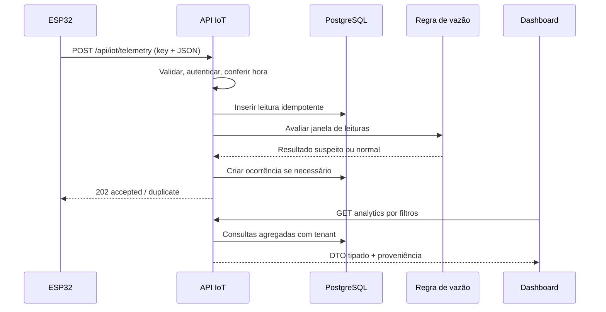

# Arquitetura proposta — monólito modular DDD-lite

## Por que não microserviços, MVC tradicional ou um backend independente agora?
A equipe tem 2 devs e 2 integrantes IoT, com poucos dias até o evento. Next.js App Router suporta UI e APIs. Um monólito modular isola domínios sem criar implantação, autenticação e tracing distribuídos. Padrão **DDD-lite + Clean**: entidades/regras puras em `domain`, orquestração em `application`, SQL/Prisma em `infrastructure`, HTTP na `app/api`, UI em `components` e `app`.

## Contextos delimitados
1. **identity**: Organization, Site, User, Role, acesso ao workspace e contexto do usuário.
2. **devices**: Device, identidade/capacidades, calibração, conectividade.
3. **telemetry**: leitura imutável, idempotência, timestamp, agregação por fonte.
4. **occurrences**: regra FlowAlertPolicy, mudança de estado, evidências e timeline.
5. **donations**: lote, validação humana, reserva, entrega confirmada.
6. **analytics**: consultas read-only agregadas, filtros, relatórios e composição de DTO.
7. **audit**: trilha de mutações e responsabilidade.

## Árvore-alvo (migrar incrementalmente)
```text
src/
  app/
    (auth)/login/page.tsx               # P1; session auth futura
    (workspace)/layout.tsx
    (workspace)/overview/page.tsx
    (workspace)/monitoramento/page.tsx
    (workspace)/ocorrencias/page.tsx
    (workspace)/doacoes/page.tsx
    (workspace)/relatorios/page.tsx
    api/
      iot/telemetry/route.ts
      analytics/overview/route.ts
      analytics/timeseries/route.ts
      analytics/drilldown/route.ts
      occurrences/[id]/route.ts
      donations/route.ts
      donations/[id]/route.ts
      devices/route.ts
      reports/summary/route.ts
  components/
    ui/                                  # shadcn reutilizáveis
    layout/                              # shell, nav, filtros
    charts/                              # water-trend, overlays, tooltip
    kpi/                                 # cards reais, não componentes demais
    occurrences/                         # lista, drawer, timeline
    donations/                            # wizard, status, confirmação
  modules/
    identity/{domain,application,infrastructure}/
    devices/{domain,application,infrastructure}/
    telemetry/{domain,application,infrastructure}/
    occurrences/{domain,application,infrastructure}/
    donations/{domain,application,infrastructure}/
    analytics/{domain,application,infrastructure}/
    audit/{application,infrastructure}/
  lib/{auth,db,errors,env,format,time}/
  generated/prisma/                      # gerado; não editar
prisma/{schema.prisma,migrations,seed.ts}
iot/esp32_richards/
scripts/iot-simulator.mjs
tests/{unit,integration,e2e}/
docs/plano/
```
**Não recriar essa árvore inteira como pastas vazias**: cada módulo surge quando for implementado; preservar caminhos atuais, criando migrações incrementais.

## Dependências permitidas
- `domain`: TypeScript puro, sem Next, Prisma, HTTP, React. Tipos, VOs, regras e transições.
- `application`: casos de uso e interfaces de repositório/clock; não renderiza UI.
- `infrastructure`: Prisma, adaptadores externos, logging estruturado; implementa ports.
- `app/api`: autentica, valida Zod, invoca use-case e traduz erros para HTTP; sem regra do negócio embutida.
- `app/(workspace)` e `components`: server/client boundaries claros; usam DTOs e hooks de filtro.
- `analytics`: somente leitura e aggregations SQL; todo filtro aceita escopo de organização.

## Fluxos de sequência


## ADRs (decisões registradas)
- **ADR-001**: Next.js fullstack, sem NestJS separado no hackathon; reconsiderar apenas se gargalo real.
- **ADR-002**: PostgreSQL + Prisma 7; migrations versionadas, `db push` apenas laboratório descartável.
- **ADR-003**: `Recharts` para BI, componentes React nativos. O HTML V3 em `iframe` é **referência/transição**, não destino final.
- **ADR-004**: HTTP/JSON ESP32 como opção suficiente. MQTT e broker só em escala futura.
- **ADR-005**: detecção via regras calibráveis, não rotular como IA preditiva sem modelo treinado.
- **ADR-006**: sem controle remoto da bomba/circuito de água pela plataforma.
- **ADR-007**: relatórios gerados no servidor, respeitando escopo, proveniência e filtros.

## Dados: integridade e performance
- Faixas de vazão/quantidade validadas; timezone salvo UTC e exibido em `America/Sao_Paulo`.
- Idempotência na constraint `(deviceId,bootId,sequence)`.
- ÍNDICES em `(deviceId,capturedAt)` e `(organizationId,status,openedAt)`; com crescimento usar agregados horários/dia.
- Paginação para timeline e histórico; limitar pontos devolvidos por gráfico, agregar na API (por exemplo 1min/15min/dia).
- Retentativas sem duplicação; tratar corrida em inserção com unique violation.
- Consultas devem usar organização do token/sessão, nunca um id vindo cegamente do cliente.

## O que já existe no starter V3
`src/components/intelligence-v3-frame.tsx` incorpora `/public/richards-bi-v3.html` e repassa leitura de `/api/analytics/overview`. `src/components/workspace-v2.tsx` contém operações Next.js. O V3 é um protótipo navegável mas filtros e writes ainda não estão nativos e consistentes no banco. Primeiro estabilizar integração; em seguida migrar o visual preservando identidade. Nunca declarar pronto antes de testes em execução.
