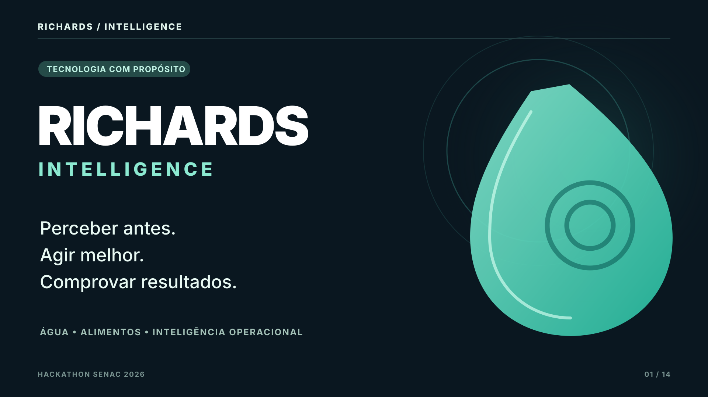

# RICHARDS Intelligence — Kit de pitch Full HD

**Status:** material de apresentação e documentação de demonstração (não altera o MVP).

14 slides em **SVG vetorial 1920 × 1080** em [slides/](slides/). Os mesmos slides podem ser exportados em **PNG Full HD**, **PowerPoint** e ZIP com o renderizador abaixo. A apresentação foi concebida para projetor 16:9 e cerca de 5 min 40 s com demo.

## Veja a narrativa em ordem

- [Perceber antes. Agir melhor. Comprovar resultados.](slides/01_capa.svg)
- [Quanto custa perceber tarde demais?](slides/02_problema.svg)
- [Escala global: desperdício alimentar, PNUMA](slides/03_dado_global.svg)
- [A história de Ellen Swallow Richards](slides/04_nome_ellen.svg)
- [Da medição à decisão verificável](slides/05_solucao.svg)
- [ESP32, API, PostgreSQL, regra, ocorrência e PDF](slides/06_arquitetura.svg)
- [Vazão persistente: evidência para investigação](slides/07_agua.svg)
- [Lote alimentar: confirmação de entrega](slides/08_alimentos.svg)
- [Visualização conceitual do centro de controle](slides/09_painel.svg)
- [O dado não termina no gráfico](slides/10_diferencial.svg)
- [O que já existe; o que ainda exige dados e validação](slides/11_inovacao.svg)
- [Operacional, ambiental e social](slides/12_impacto.svg)
- [Piloto, calibração e impacto comprovável](slides/13_viabilidade.svg)
- [A demonstração e o fechamento](slides/14_encerramento.svg)

### Capa



## Como gerar imagens PNG e PPTX

```bash
python -m pip install -r presentation/requirements-pitch.txt
python presentation/render_slides.py
```

Os arquivos serão gerados em `presentation/export/` (não versionados, para não inflar o repositório). Os SVGs são os arquivos de imagem editáveis e independentes de dependências.

## Organização

- [ROTEIRO_PALCO.md](ROTEIRO_PALCO.md) — história, minutagem, fala, cliques, plano B e respostas à banca.
- [CHECKLIST_VICTOR_IOT.md](CHECKLIST_VICTOR_IOT.md) — contrato, hardware, sensores, rede, calibração e evidência.
- [PLANO_FINAL.md](PLANO_FINAL.md) — cronograma de P0, riscos, qualidade e teste de aceite.
- [slides/](slides/) — 14 imagens vetoriais 1920 × 1080.
- `render_slides.py` — gerador local de PNG, PPTX e ZIP.

## Por que RICHARDS?

Homenagem a **Ellen Swallow Richards (1842–1911)**, pioneira da química sanitária, da qualidade da água e dos estudos de ambiente, alimentação e saúde. Fontes: [MIT Libraries](https://digital-exhibits.libraries.mit.edu/s/under-the-lens/page/Richards) e [Science History Institute](https://www.sciencehistory.org/education/scientific-biographies/ellen-h-swallow-richards/).

## Honestidade técnica

**Hoje:** telemetria, regra de vazão, ocorrências, intervenções, doações e PDF. **Depois:** modelos de IA somente após séries confiáveis, rótulos e validação. Litros monitorados não são litros economizados; quilos cadastrados não são doações confirmadas. Os valores do histórico simulado precisam continuar identificados como SIMULATED.

**Dado global do slide 03:** 1,05 bilhão de toneladas em 2022, em varejo, serviços de alimentação e domicílios; o total inclui partes não comestíveis. Fonte: [PNUMA/UNEP Food Waste Index 2024](https://www.unep.org/en/news-and-stories/press-release/world-squanders-over-1-billion-meals-day-un-report).

**Escopo do código:** intocado neste pacote. Testes integrados, ESP32 e hardware precisam ser verificados pelo time; ver [docs/ROTEIRO_DEMO.md](../docs/ROTEIRO_DEMO.md).
